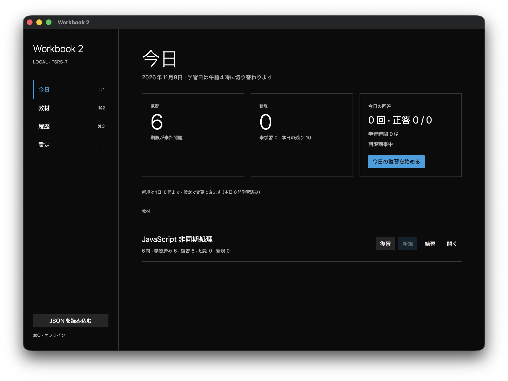
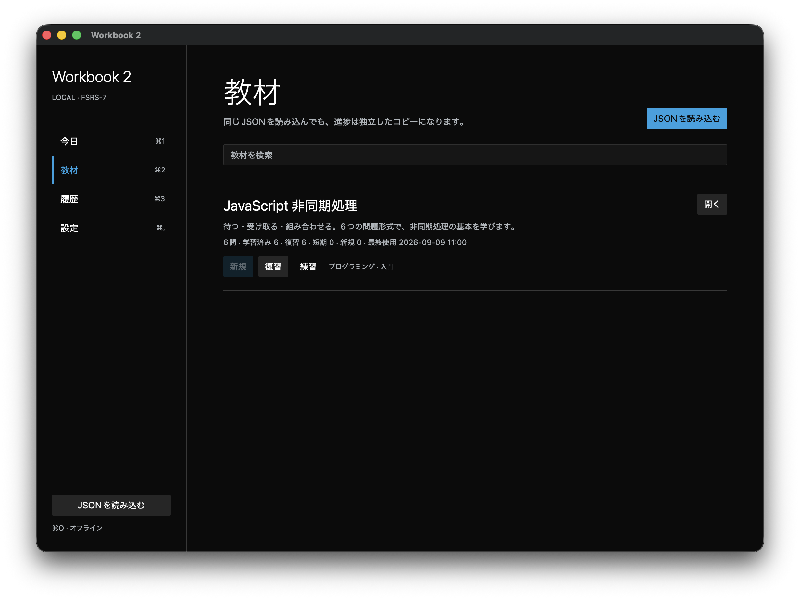
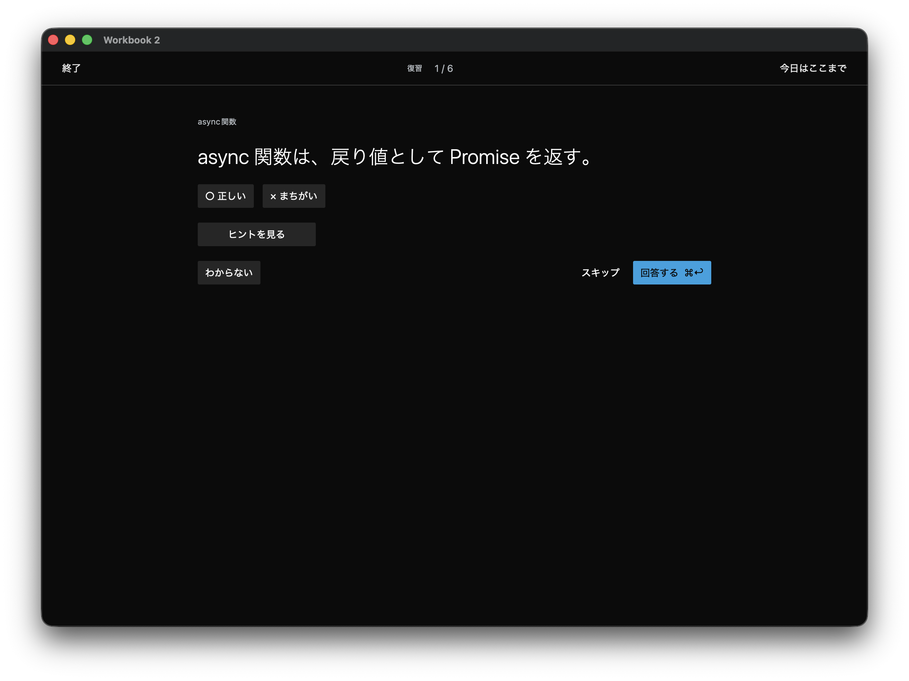
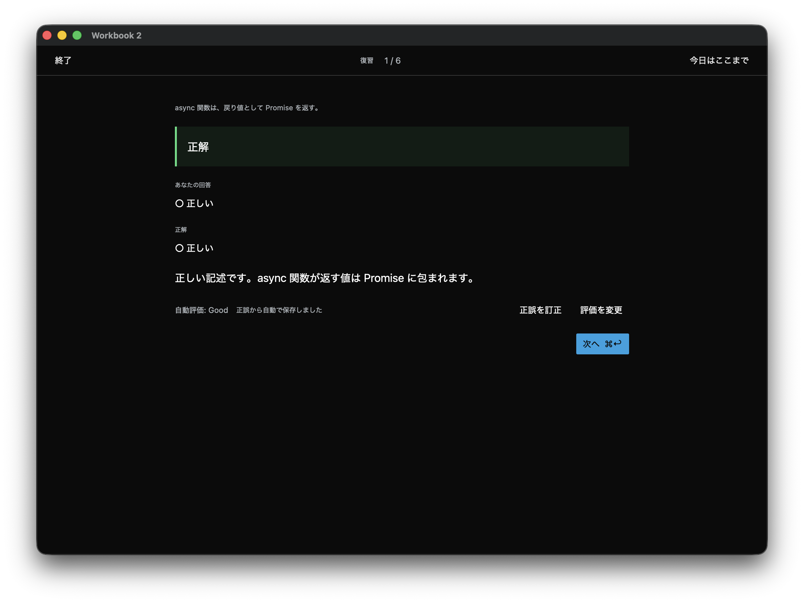
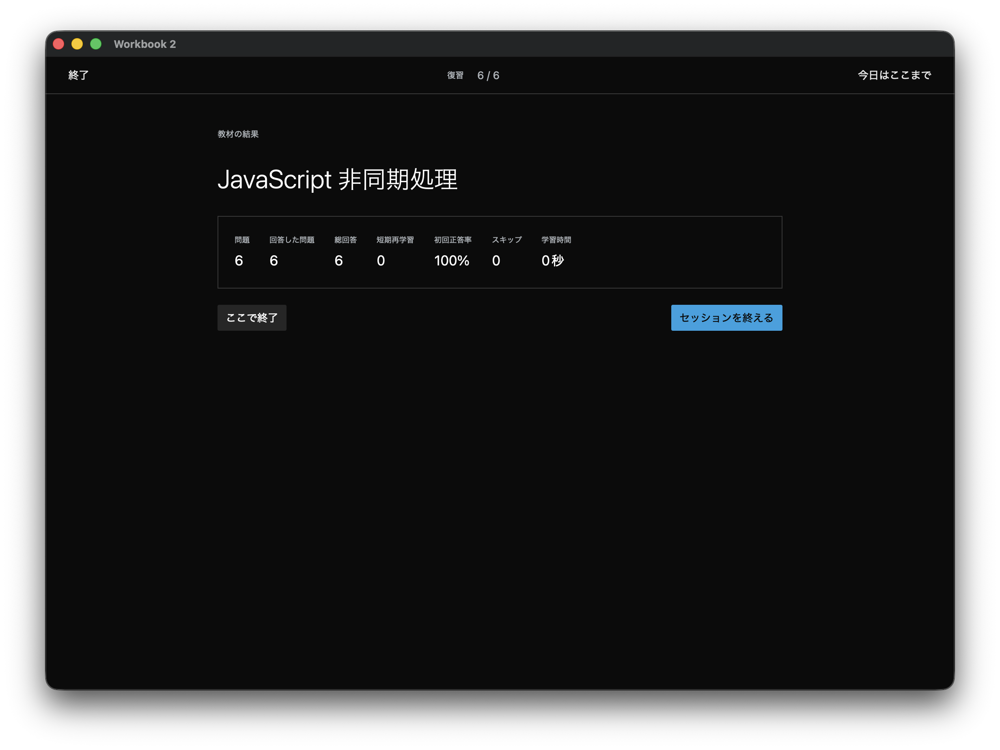
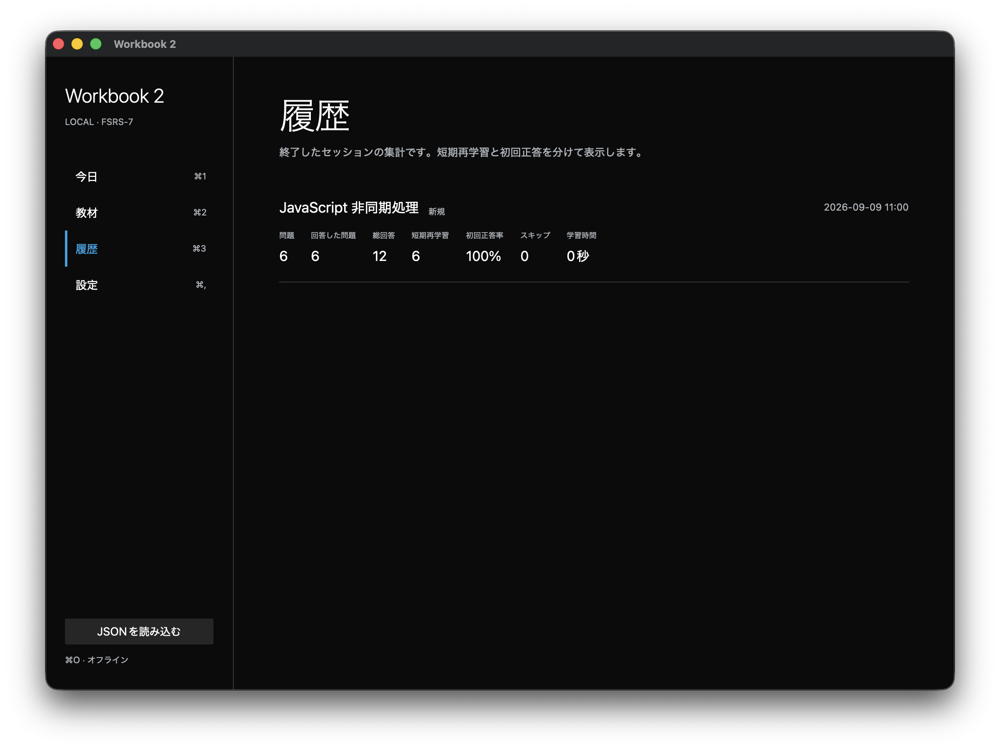
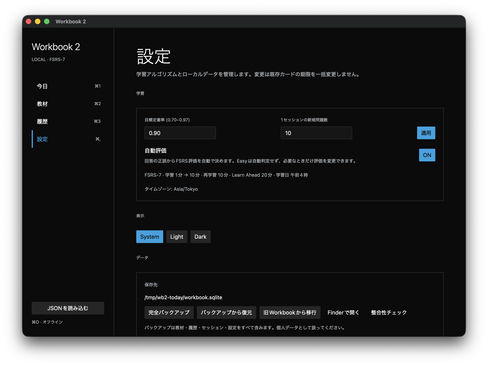
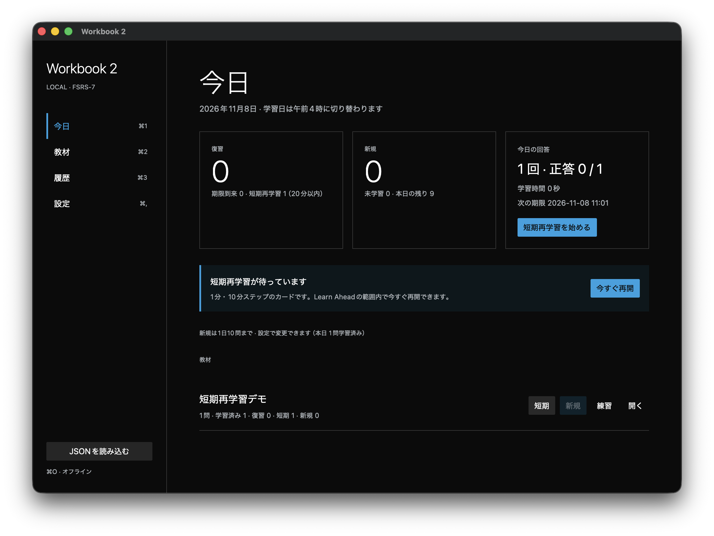

# Workbook 2

既存の Electron 製 **Workbook 0.1.0** を、**Rust + GPUI + SQLite** で作り直した macOS ネイティブアプリです。WebView、Electron、クラウド、アカウントはありません。既存アプリのデータディレクトリ・アプリID・DBを書き換えません。

> 最初は教えてくれる。次からは思い出させる。



## 実装状況

| 領域 | 状態 |
|---|---|
| M0 旧ソース監査・Golden Fixture | 完了（[docs/AUDIT.md](docs/AUDIT.md), [docs/COMPATIBILITY.md](docs/COMPATIBILITY.md)） |
| M1 Domain / SQLite / Scheduler / Clock / Queue / Session | 完了 |
| M2 GPUI 学習フロー（Today / Study / Feedback / Result / History） | 完了 |
| M3 Library / Settings / Legacy v1 移行 / Backup / Restore | 完了 |
| M4 macOS `.app`、Light/Dark、スクリーンショット、ドキュメント | 完了（署名・公証・VoiceOver全画面監査は未実施） |

### 実装済み

- FSRS-7（`fsrs-rs` の v7 モデル、固定コミット）と、旧 `ts-fsrs 6.0.0 DefaultScheduler` 互換の短期ステップ
- Learning Steps `1分 → 10分`、Relearning `10分`、Desired Retention 既定 `90%`、Learn Ahead `20分`
- 評価確定時に FSRS状態・Attempt・Session・Note初回学習・関連問題の延期を **1 SQLite トランザクション**で保存
- 回答の正誤からFSRS評価を自動決定し、回答確認と同時に保存（既定ON）。不正解・「わからない」は Again、ヒント使用後の正解は Hard、ヒントなし正解は Good。Easyは自動判定せず、必要なときだけ手動で訂正
- 自動採点できないフラッシュカードは従来の手動評価へフォールバック
- 回答ごとの独立 Attempt ID、同一問題の短期再出題も全件履歴、二重送信の冪等性、訂正時の再計算
- 次問を毎回 DB の現在状態から再選択する動的キュー
- 期限到来済み Learning/Relearning → 通常 Review/New → 20分以内 Learn Ahead → 結果、の優先順位
- 同じ Note の別 Question の抑制と、同じ Question の短期再出題
- Today の復習/新規/短期再学習件数、Workbook別内訳、次の期限
- 起動時・セッション開始/再開・回答確定後の再評価、ウィンドウ再アクティブ時と期限タイマーによる更新
- JSON教材の検証・プレビュー・独立コピー・安全な削除
- 旧 Electron v1 DB の読み取り専用ステージング検査と移行
- 完全バックアップ、7世代の日次バックアップ、復元前/削除前/移行前/リセット前の安全バックアップ
- Light / Dark / System、Cyanアクセント、キーボード操作、GPUI Kit の IME対応 Input

### 意図的な制約

- 外部画像は取得せず、代替テキストとURLを表示します（オフライン優先）
- Markdown は GPUI の rich text で表示します。KaTeX 相当の数式組版は行わず、math ブロックは等幅テキストで表示します
- VoiceOver を使った全画面手動監査、日本語IMEの実機手動確認、Developer ID署名・公証は未実施です。実装は GPUI Kit の AccessKit / IME 対応に依存しています
- Windows / Linux は設計上分離していますが、ビルド・実機検証はしていません
- 旧DBは実在する **schema v1 のみ**対応です。監査で v2 は確認されませんでした

## 起動

必要環境: macOS (Apple Silicon)、Rust stable 1.96 以降、Xcode、Metal Toolchain。

```sh
# 初回のみ（GPUI の Metal シェーダコンパイルに必要）
xcodebuild -downloadComponent MetalToolchain

cargo run -p workbook-app --bin workbook2
```

データは既定で `~/Library/Application Support/Workbook2/` に保存されます。検証時は `WORKBOOK2_DATA_DIR` で独立ディレクトリを指定できます。

```sh
WORKBOOK2_DATA_DIR=/tmp/workbook2-dev cargo run -p workbook-app --bin workbook2
```

### アプリバンドル

```sh
./scripts/package-macos.sh
open "dist/Workbook 2.app"
```

`dist/Workbook 2.app` は ad-hoc 署名のみのローカルビルドです。配布には Apple Developer ID 署名と公証が別途必要です。

## 操作

| キー | 動作 |
|---|---|
| `⌘1` / `⌘2` / `⌘3` | Today / Library / History |
| `⌘,` | Settings |
| `⌘O` | JSON教材を読み込む |
| `⌘F` | Library の検索へ |
| `⌘Return` | 回答チェック / 次へ（手動評価時は評価確定） |
| Feedback中の `1` `2` `3` `4` | Again / Hard / Good / Easy（入力フォーカスなし時。自動評価後は「評価を変更」を開いたときだけ有効） |
| `Esc` | 終了確認（進行を勝手に破棄しません） |

すべての操作はマウスからも実行できます。テキスト入力中は数字キーを評価に使いません。

## FSRS 自動化の流れ

1. `EvaluateAnswer`: 正誤・ヒント・「わからない」を確定し、自動評価ポリシーで rating を決定（手動評価時は FSRS/Attempt をまだ書かない）
2. 自動評価ON: 同じサービス呼び出し内で `CommitRating` 相当を実行し、回答確認と保存を原子的に完了
3. 自動評価OFF: 従来どおり Again/Hard/Good/Easy を選択
4. `CommitRating`: 保存済みの評価前状態と実回答時刻から FSRS-7 を計算
5. 短期ステップまたは FSRS の長期間隔から `due_at` を決定
6. FSRS状態・Attempt・Sessionカーソル・Note初回学習・関連問題の延期を同一トランザクションで保存
7. 次問選択時に候補を再計算（固定キューではない）
8. Today とタイマーが SQLite の期限から件数・次の期限を再計算

自動評価の rating は `attempts.rating_source` に `automatic` / `manual` として保存します。評価を訂正した場合は同じAttempt行を更新し、評価前状態からFSRSを再計算します。自動評価でもFSRSの数式・ステップ・キューは変わりません。

詳細は [docs/ARCHITECTURE.md](docs/ARCHITECTURE.md) と [docs/COMPATIBILITY.md](docs/COMPATIBILITY.md)。

## テスト

```sh
cargo fmt --check
cargo clippy --workspace --all-targets -- -D warnings
cargo test --workspace
cargo check --workspace
./scripts/package-macos.sh
```

固定Clockを使い、実時間を待たずに以下を検証します。

- 旧 `ts-fsrs 6.0.0` の Golden Fixture（New/Learning/Review/Relearning × 4評価、長期間隔）
- 1分/10分ステップ、Againでの巻き戻り、卒業、Relearning
- Learn Ahead 19分59秒 / 20分 / 20分01秒、午前4時をまたぐ前倒し禁止
- シナリオA（新規 Again → Learn Ahead → Good → Review）
- シナリオB（Review期限 → 復習 → Again → Relearning → 再回答 → 新Review期限）
- シナリオC（再起動・期限後復習・Attempt二重作成なし）
- Today の実データ件数、短期再学習待ち、次の期限
- 関連Noteの抑制、同一Questionの再出題、複数WorkbookのResult
- 二重送信・評価訂正・stale revision・Practice/Skipの非更新
- 自動評価（不正解/わからない→Again、ヒント正解→Hard、ヒントなし正解→Good、Easy非自動）
- 自動採点不可のフラッシュカードの手動フォールバック、自動評価の手動訂正、訂正時のAttempt非重複
- 自動評価と手動評価で同一rating・回答時刻・評価前状態から同一FSRS結果になること
- 自動評価の再起動復旧、設定の途中変更、v1 DBの安全なスキーマ移行
- 旧v1 DB移行、バックアップ/復元、破損DB拒否、7世代保持
- 独立コピーと削除

## スクリーンショット

| Today | Library |
|---|---|
|  |  |

| Study | Feedback |
|---|---|
|  |  |

| Result | History |
|---|---|
|  |  |

| Settings | 短期再学習待ち |
|---|---|
|  |  |

## データ安全性

- 新アプリID: `1463962418`（`"WBK2"`）。旧アプリID `1463962443` とは別
- 既定データ先: `~/Library/Application Support/Workbook2/`
- 旧WorkbookのDBは読み取り専用でコピーし、検査・変換後のみ新DBへ追加
- 移行・削除・復元・履歴リセットの前に安全用バックアップ
- 使用中DBへの単純コピーをせず SQLite backup API を使用
- 復元は整合性・外部キー・スキーマ・内容を検証してから置換。失敗時はロールバック
- 学習中のセッションがある教材は削除不可

移行手順は [docs/MIGRATION.md](docs/MIGRATION.md)。

## ライセンス

MIT。GPUI Kit / GPUI はそれぞれのライセンスに従います。
